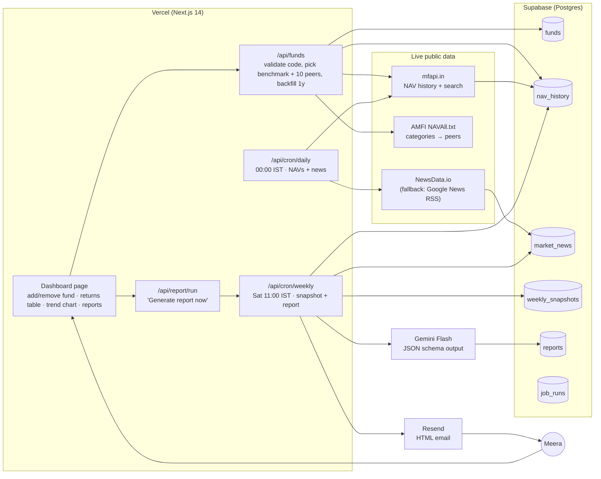

# Components Map

| Component | Role |
|---|---|
| **mfapi.in** | Daily NAVs for each fund, its benchmark proxy and its category peers; scheme search for the add-fund form. |
| **AMFI NAVAll.txt** | Maps each fund's category to 10 Direct-Growth peers for the category average. |
| **Index proxies** | Index-fund NAVs standing in for the three tracked indices: Nifty 50, Nifty Midcap 150, Nifty Smallcap 100. Debt and overseas funds are compared with their similar-funds average only. |
| **NewsData.io** | Daily Indian market and macro headlines, stored so the weekly report sees 7 days of news. |
| **Supabase** | Stores funds, NAV history, news, weekly snapshots (for multi-week trends), reports, and job_runs (when each job last ran, shown as "Last updated" on the dashboard). |
| **Daily cron** | Refreshes NAVs and news every night. |
| **Weekly cron** | Computes WoW/MoM/YTD for each fund vs benchmark vs category, gets index moves, calls Gemini, saves the report, sends the email. |
| **Gemini Flash** | Writes a 3-sentence plain-language summary per fund plus one verdict: *No action needed / One fund worth watching / Consider reviewing your allocation*. |
| **Resend** | Delivers the Saturday-morning email. |
| **Dashboard** | "Last updated" strip, add or remove a fund by scheme code (or name search), latest returns with status labels, growth chart (week / month / year), beginner guide sidebar, past reports, manual run. |
