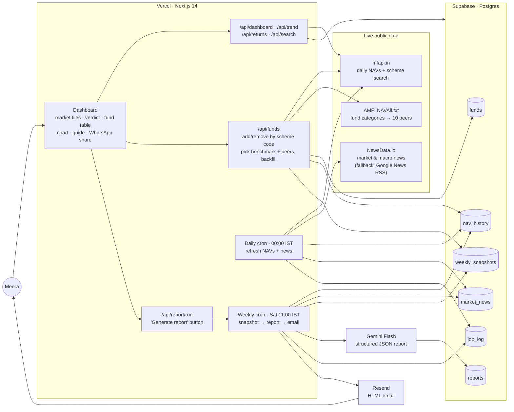

# Components Map

**Fund Pulse**: a weekly mutual fund tracker for Meera (Problem Statement 19).
Live: https://mf-tracker-delta.vercel.app · Repo: https://github.com/snehaiyer-beep/mf-tracker

## Components

| Component | Role |
|---|---|
| **mfapi.in** | Live NAV history for each fund, its benchmark stand-in and its 10 peers; powers the fund search box. |
| **AMFI NAVAll.txt** | Official list of every scheme and its category; used to pick 10 Direct-Growth peers for the category average. |
| **Index stand-ins** | mfapi has no index data, so index-fund NAVs stand in for (1) the **market context**: Nifty 50, Nifty Midcap 150, Nifty Smallcap 100, and (2) each fund's **stated benchmark**, e.g. NIFTY Smallcap 250 TRI, CRISIL Short Duration Debt A-II, US tech via Nasdaq 100. |
| **NewsData.io** | Indian market and macro headlines, fetched daily and stored so the Saturday report sees the whole week. |
| **Supabase** | `funds` (tracked funds, benchmark, peers) · `nav_history` (6 years of daily NAVs) · `market_news` · `weekly_snapshots` (WoW/MoM/YTD vs benchmark vs category, for multi-week trends) · `reports` (Gemini output + verdict) · `job_log` (every automatic/manual run and its result). |
| **Daily cron** (Vercel, 00:00 IST) | Refreshes NAVs for funds, peers and indices; stores the day's news; logs the run. |
| **Weekly cron** (Vercel, Sat 11:00 IST) | Computes returns for each fund vs its stated benchmark vs similar funds, gets the 3 index moves and the week's news, asks Gemini for the report, saves it, emails it, logs the run. |
| **Gemini Flash** | Returns schema-checked JSON: a 3-sentence plain-language summary per fund (performance, benchmark/category comparison, market reason) and a closing verdict: *No action needed / One fund worth watching / Consider reviewing your allocation*, naming the fund and the reason. |
| **Resend** | Delivers the Saturday-morning email, which closes with the overall portfolio assessment. |
| **Dashboard** | Last-updated strip + automation history · market tiles · verdict banner · fund table (Week / Month / Since Jan or any past year / 1 Year, with status labels and summaries) · chart (12 weeks, 12 months, 1 year) · "How to read this" guide · WhatsApp share image · add/remove funds by scheme code · past reports. |

## Data flow in one line

**Every night** prices and news are saved → **every Saturday** returns are compared with the benchmark and similar funds, Gemini explains them in plain language, and Meera gets an email → **any time** she opens the dashboard to see the same picture, with history, and can share it on WhatsApp.
